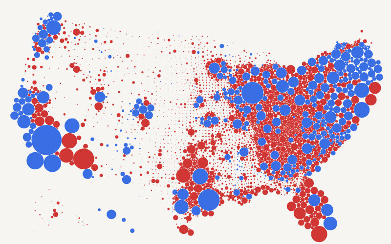
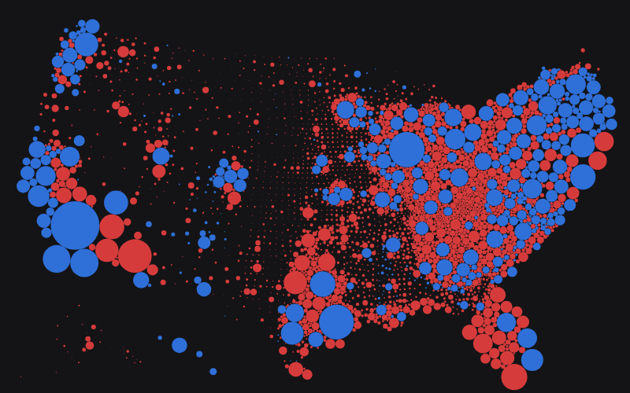
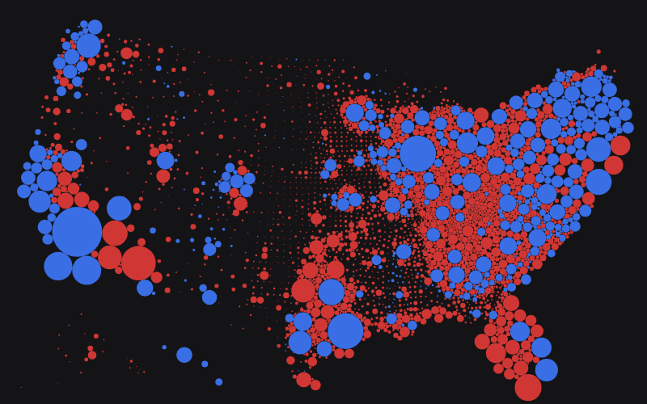
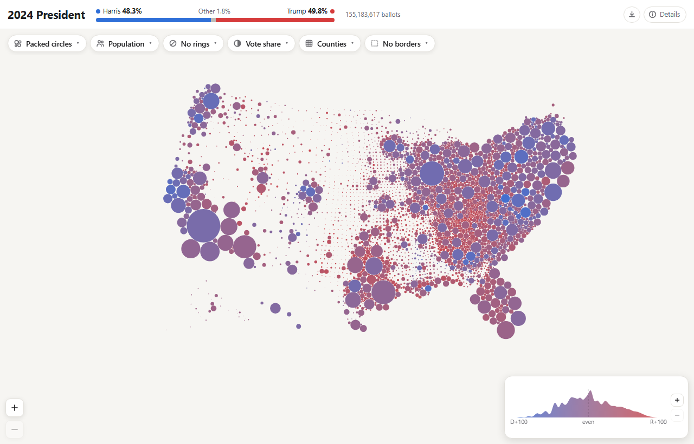
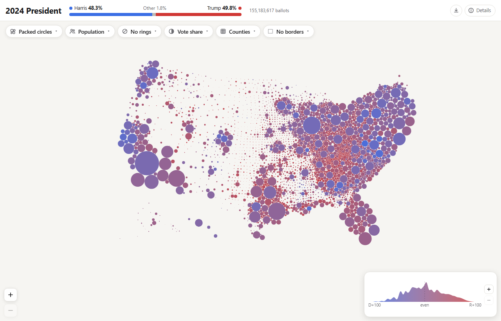

Both party colors now sit at OKLCH lightness 0.570 and chroma 0.190 (Democratic `#3a6ee5`, Republican `#d03734`), so the whole blue-to-red scale holds one lightness. Before, the red was lighter and more saturated than the blue.

**Winner coloring** (pure party colors), 2024 President

| Before | After |
| --- | --- |
|  |  |
|  |  |

**Vote share coloring**, light mode: header bar, map and legend scale

| Before | After |
| --- | --- |
|  |  |

**Favicon** at 96, 32 and 16 px, on light and dark

| Before | After |
| --- | --- |
|  |  |
