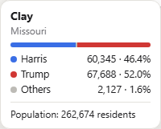
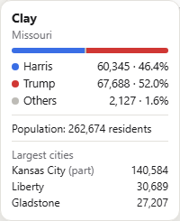
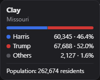
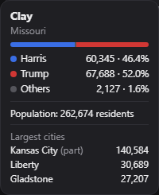
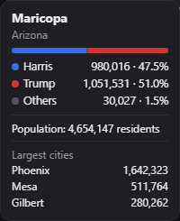

Hovering a county now lists its largest cities. A city that crosses county lines is marked "(part)" and counts only the people inside that county.

| Before | After |
| --- | --- |
|  |  |
|  |  |

Maricopa County AZ, dark:

